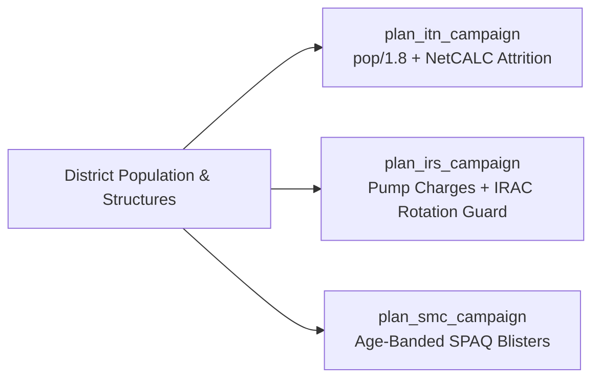

# vector-plan

[](https://github.com/codesphere-u/vector-plan/actions/workflows/ci.yml)
[](LICENSE)
[](pyproject.toml)
[](pyproject.toml)

**Zero-dependency WHO malaria vector-control microplanner: ITN/LLIN pop/1.8 campaign & NetCALC attrition curves, IRS insecticide sachet/pump-charge & IRAC resistance rotation guard, and SMC SPAQ quantification.**

- **Mission Domain:** Public Health & Malaria Vector Control (WHO)
- **Stack:** Pure Python 3.11+ (zero runtime third-party dependencies, `mypy --strict`, `ruff`, `pytest`)
- **Maintainer:** Codesphere Innovations (U) Limited (`codesphere-u`)

---

## Problem Solved

District malaria programs lose protective impact when bed-net attrition drops coverage below 80% before Year 3 or when repeated single-class IRS spraying accelerates pyrethroid and organophosphate mosquito resistance.

## Key Features

- WHO ITN/LLIN universal-coverage mass campaign planner (`population / 1.8` + buffer + 50-net bales), Weibull NetCALC 3-year survival & month-below-80% forecast, and ANC/EPI continuous top-up quantification (`plan_itn_campaign`).
- WHO PQT-VC Indoor Residual Spraying (IRS) quantifier (`plan_irs_campaign`) computing porous mud-wall surface area, 10L Hudson pump charges, spray-operator teams, pyrethroid-resistance blocks, and 2-year IRAC Mode-of-Action rotation enforcement.
- Seasonal Malaria Chemoprevention (SMC) age-banded (`3–11m` & `12–59m`) SPAQ blister-pack quantification (`plan_smc_campaign`).

## Architecture Overview



See [docs/architecture.md](docs/architecture.md) for module-level design details.

## Installation

```bash
git clone https://github.com/codesphere-u/vector-plan.git
cd vector-plan
uv sync --extra dev
```

Or install in editable mode with standard `pip`:

```bash
pip install -e ".[dev]"
```

## Quick Start (CLI)

```bash
vector-plan --population 180000 --structures 38000 --insecticide sumishield_50wg --prior-moa 1B 1B
```

## Quick Start (Python API)

```python
from vector_plan import plan_irs_campaign, plan_itn_campaign

itn = plan_itn_campaign(population=180000)
irs = plan_irs_campaign(target_structures=20000, insecticide_key='sumishield_50wg', prior_years_moa_history=['1B', '1B'])
assert itn.mass_campaign_nets_required == 110000 and not irs.resistance_rotation_warnings
```

## Testing & Quality Gates

```bash
uv run ruff check src tests
uv run mypy src
uv run pytest -v
```

## Security, Contributing & Roadmap

- **Security:** See [SECURITY.md](SECURITY.md) for responsible disclosure procedures.
- **Contributing:** See [CONTRIBUTING.md](CONTRIBUTING.md) and [CODE_OF_CONDUCT.md](CODE_OF_CONDUCT.md).
- **Changelog & Roadmap:** See [CHANGELOG.md](CHANGELOG.md) and [ROADMAP.md](ROADMAP.md).

## License

MIT License — see [LICENSE](LICENSE).

## Support & Contact

Open an issue on [GitHub Issues](https://github.com/codesphere-u/vector-plan/issues) or contact `codesphereinnovationz@gmail.com`.
